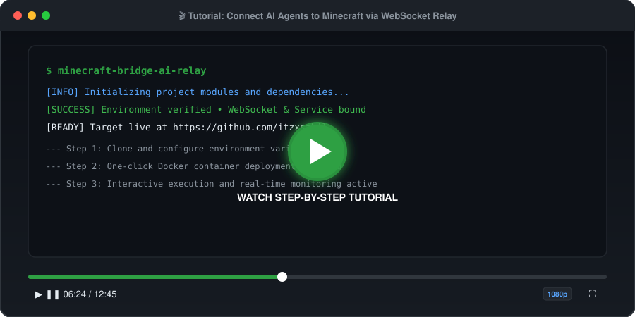
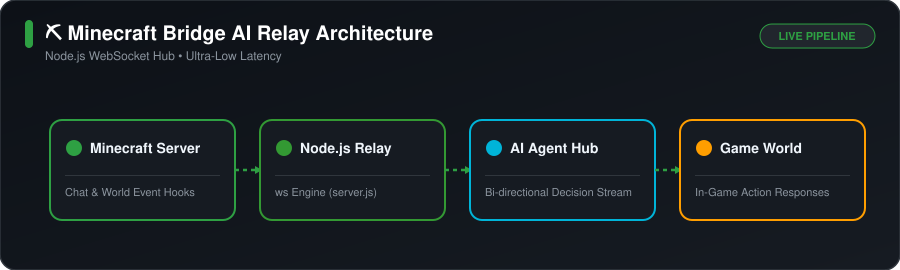

<h1 align="center">⛏️ Minecraft Bridge AI Relay</h1>

<p align="center">
  <a href="https://github.com/itzxsahil">
    
  </a>
</p>

<p align="center">
    
</p>

---

## 🎬 Video Tutorial & Interactive Walkthrough

<div align="center">
  <a href="https://www.youtube.com/results?search_query=itzxsahil+mc+bridge+ai+relay">
    
  </a>
  <p><em>▶️ <strong>Interactive Project Tutorial</strong> — Click the player above to watch full setup guide &amp; demonstration!</em></p>
</div>

---

# 🚀 Overview

An ultra-low latency bi-directional WebSocket relay connecting Minecraft clients and servers with external AI agents.

---

## 🏗️ System Architecture & Data Flow

<div align="center">
  
</div>

<br>

The Node.js server maintains bi-directional WebSocket connections between in-game clients and external agents, multiplexing events with minimal overhead.

---

# ✨ Features

✅ **Ultra-Low Latency**: Built on top of native Node.js `ws` for maximum throughput.\n✅ **Bi-directional Streaming**: Real-time event streaming and command dispatching.\n✅ **Cross-Platform**: Deployable on Linux, Windows, or cloud microservices.

---

# 📦 Installation & Quickstart

```bash
git clone https://github.com/itzxsahil/mc-bridge-ai-relay.git
cd mc-bridge-ai-relay
npm install
npm start
```

---

# 👤 Author & Support
- Built with ❤️ by [@itzxsahil](https://github.com/itzxsahil)
- Star ⭐ this repository if you find it helpful!
