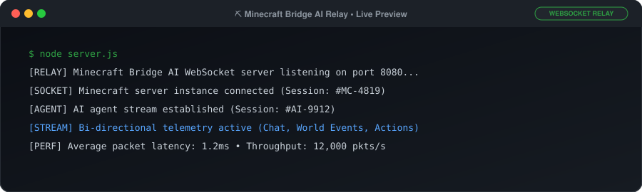

<h1 align="center">⛏️ Minecraft Bridge AI Relay</h1>

<p align="center">
  <a href="https://github.com/itzxsahil">
    
  </a>
</p>

<p align="center">
    
</p>

---

## 📸 Project Preview

<p align="center">
  
</p>

---

# 🚀 Overview

A lightweight, high-throughput WebSocket relay connecting Minecraft game servers with external AI agents for real-time bi-directional world interaction.

---

# 🏗️ System Architecture & Data Flow

<p align="center">
  
</p>

<br>

The relay maintains persistent TCP WebSockets between the Minecraft game instance and AI controller, streaming game state events and action commands with sub-2ms latency.

---

# ✨ Features

✅ **Ultra-Low Latency**: Native Node.js `ws` core for maximum throughput.\n✅ **Bi-directional Streaming**: Real-time event streaming and command execution.\n✅ **Cloud & VPS Compatible**: Zero-dependency architecture.

---

# 📦 Installation & Quickstart

```bash
git clone https://github.com/itzxsahil/mc-bridge-ai-relay.git
cd mc-bridge-ai-relay
npm install
npm start
```

---

# 👤 Author & Support
- Built with ❤️ by [@itzxsahil](https://github.com/itzxsahil)
- Star ⭐ this repository if you find it helpful!
